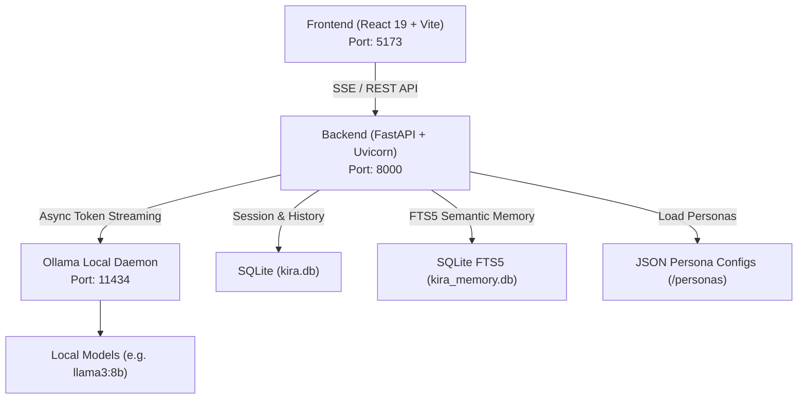

# 🌌 K.I.R.A — Knowledge-based Intelligent Responsive Assistant

> **A 100% local-first, multi-persona AI platform running entirely on your own hardware.**  
> Powered by **Ollama**, a high-performance **FastAPI** Python backend, and a modern **React 19 / Vite** chat interface.

---

## 📖 Table of Contents

- [Overview](#-overview)
- [Key Features](#-key-features)
- [Architecture & Tech Stack](#-architecture--tech-stack)
- [Project Structure](#-project-structure)
- [System Requirements](#-system-requirements)
- [Getting Started (Step-by-Step)](#-getting-started-step-by-step)
  - [1. Prerequisites & Ollama Setup](#1-prerequisites--ollama-setup)
  - [2. Clone the Repository](#2-clone-the-repository)
  - [3. Backend Setup](#3-backend-setup)
  - [4. Frontend Setup](#4-frontend-setup)
  - [5. Launching the Platform](#5-launching-the-platform)
- [Personas System](#-personas-system)
- [Memory Bank & FTS5 Retrieval](#-memory-bank--fts5-retrieval)
- [Keyboard Shortcuts](#-keyboard-shortcuts)
- [API Reference](#-api-reference)
- [Environment Configuration](#-environment-configuration)
- [Troubleshooting](#-troubleshooting)

---

## ⚡ Overview

**K.I.R.A** is a privacy-first, cloud-independent AI companion and productivity suite. Unlike cloud-dependent AI interfaces, K.I.R.A guarantees that:
- **Zero data leaves your machine**: All token generation, conversation history, and user memories are processed and stored locally.
- **Multiple AI Personas**: Switch between specialized personas on the fly (Intelligent Assistant, Senior Technical Mentor, Casual Friend, Empathetic Companion) or define your own using simple JSON schemas.
- **Persistent Long-Term Memory**: Uses SQLite Full-Text Search (FTS5) to maintain cross-session context, personal user preferences, and persona-specific recollections without requiring heavyweight cloud vector databases.

---

## ✨ Key Features

- 🔒 **100% Local Inference**: Connects directly to your local Ollama daemon (`http://localhost:11434`).
- 🎭 **Dynamic Persona Engine**:
  - **K.I.R.A (Assistant)**: Analytical, accurate, concise coding and productivity assistant.
  - **Marcus (Mentor)**: Senior staff engineer coach for system design, data structures, and career guidance.
  - **Sam (Friend)**: Witty, relaxed, and casual conversational partner.
  - **Aria (Companion)**: Empathetic, supportive, and emotionally warm listener.
- 🎨 **Modern Dark-Theme UI**:
  - Cheerful main screen character selector with custom gradients and ambient glow badges.
  - Real-time Server-Sent Events (SSE) token streaming with smooth typing effects.
  - Full GitHub-flavored Markdown rendering with code blocks and copy-to-clipboard utilities.
  - Responsive collapsible sidebar (smoothly collapses into a compact 68px icon rail on desktop, drawer on mobile).
  - Conversation management: 3-dots context menu with inline **Rename** and modal **Delete**.
  - Interactive **Memory Bank** modal to inspect, filter, and add cross-session user memories.
  - Model settings modal to configure temperature, top-p, and switch between installed local Ollama models.
- ⌨️ **Keyboard Navigation**: Productivity shortcuts (`Ctrl+B`, `Ctrl+N`, `Escape`, `Enter`).

---

## 🛠️ Architecture & Tech Stack



| Component | Technology | Description |
| :--- | :--- | :--- |
| **Frontend** | React 19, Vite, Lucide Icons | Responsive chat application and design system |
| **Backend** | Python 3.10+, FastAPI, Uvicorn | Asynchronous REST and Server-Sent Events (SSE) API |
| **Local LLM Engine**| Ollama (`ollama-python`) | Hardware-accelerated local model execution |
| **Chat Storage** | SQLite (`kira.db`) | Sessions, message transcripts, and timestamps |
| **Memory Engine** | SQLite FTS5 (`kira_memory.db`) | Tokenized keyword & semantic context retrieval |

---

## 📂 Project Structure

```
KIRA/
├── backend/
│   ├── memory/
│   │   ├── store.py           # SQLite sessions and chat message storage
│   │   └── vector_store.py    # SQLite FTS5 long-term memory engine
│   ├── personas/
│   │   ├── assistant.json     # K.I.R.A Assistant personality configuration
│   │   ├── mentor.json        # Marcus Technical Mentor configuration
│   │   ├── friend.json        # Sam Casual Friend configuration
│   │   ├── companion.json     # Aria Empathetic Companion configuration
│   │   ├── schema.py          # Pydantic validation schema
│   │   └── loader.py          # Persona loader and registry
│   ├── routes/
│   │   ├── chat.py            # Chat streaming, session rename & delete endpoints
│   │   ├── memory.py          # Memory bank search and CRUD endpoints
│   │   └── personas.py        # Persona list and installed model discovery
│   ├── config.py              # Environment variable loader
│   ├── main.py                # FastAPI entrypoint and lifespan manager
│   ├── ollama_client.py       # Async Ollama client for streaming completions
│   ├── requirements.txt       # Python backend dependencies
│   └── .env                   # Backend configuration file
├── frontend/
│   ├── public/                # Static assets, SVG logos, and icons
│   ├── src/
│   │   ├── api/
│   │   │   └── client.js      # Fetch API & SSE streaming client
│   │   ├── components/
│   │   │   ├── Chat/          # ChatView, ChatInput, MessageBubble, EmptyState
│   │   │   ├── Settings/      # SettingsModal, MemoryModal
│   │   │   └── Sidebar/       # Sidebar, chat history list, 3-dots menu
│   │   ├── utils/
│   │   │   └── markdown.js    # Markdown renderer and syntax formatter
│   │   ├── App.jsx            # Top-level state and layout container
│   │   ├── index.css          # Dark-theme design system and custom styling
│   │   └── main.jsx           # React DOM root entrypoint
│   ├── index.html             # HTML5 template
│   ├── package.json           # Frontend dependencies and npm scripts
│   ├── vite.config.js         # Vite configuration with API reverse proxy
│   └── .env                   # Frontend environment configuration
├── .gitignore                 # Git ignore rules
└── README.md                  # Project documentation
```

---

## 💻 System Requirements

- **Operating System**: Windows 10/11, macOS (Apple Silicon or Intel), or Linux.
- **Python**: Version `3.10` or newer.
- **Node.js**: Version `18.0` or newer (Node 20+ recommended).
- **Ollama**: Installed and running locally ([Download Ollama](https://ollama.com/download)).
- **Hardware Recommendation**:
  - 8 GB RAM minimum (16 GB+ recommended for 7B/8B models).
  - Modern CPU with AVX2 or dedicated GPU (NVIDIA CUDA / Apple Metal) for fast inference.

---

## 🚀 Getting Started (Step-by-Step)

Follow these steps to set up and run K.I.R.A from scratch on a clean system.

### 1. Prerequisites & Ollama Setup

1. Download and install [Ollama](https://ollama.com/download).
2. Open your terminal and start Ollama (or ensure the background tray app is running):
   ```bash
   ollama serve
   ```
3. Pull your preferred model (e.g. `llama3:8b` or `mistral`):
   ```bash
   ollama pull llama3:8b
   ```
4. Verify the model is installed:
   ```bash
   ollama list
   ```

---

### 2. Clone the Repository

```bash
git clone https://github.com/YourUsername/KIRA.git
cd KIRA
```

---

### 3. Backend Setup

1. Open a terminal in the project root and navigate to the `backend` directory:
   ```bash
   cd backend
   ```
2. Create and activate a Python virtual environment:
   - **Windows (PowerShell)**:
     ```powershell
     python -m venv venv
     .\venv\Scripts\Activate.ps1
     ```
   - **macOS / Linux**:
     ```bash
     python3 -m venv venv
     source venv/bin/activate
     ```
3. Install the required Python packages:
   ```bash
   pip install -r requirements.txt
   ```
4. Configure environment variables (a pre-configured `.env` is included, or create one):
   ```ini
   PORT=8000
   HOST=127.0.0.1
   OLLAMA_HOST=http://localhost:11434
   SQLITE_DB_PATH=kira.db
   MEMORY_DB_PATH=kira_memory.db
   ```

---

### 4. Frontend Setup

1. In a new terminal tab, navigate to the `frontend` directory:
   ```bash
   cd frontend
   ```
2. Install the Node.js dependencies:
   ```bash
   npm install
   ```
3. Verify the frontend environment file (`frontend/.env`):
   ```ini
   VITE_API_BASE_URL=/api
   VITE_BACKEND_URL=http://localhost:8000
   ```

---

### 5. Launching the Platform

You will run the backend and frontend simultaneously in separate terminals:

#### Terminal 1 — Start the Backend Server:
From the `backend/` directory with the virtual environment activated:
```bash
uvicorn main:app --reload --port 8000
```
> The API will be available at: `http://localhost:8000` (Swagger docs at `http://localhost:8000/docs`).

#### Terminal 2 — Start the Frontend Dev Server:
From the `frontend/` directory:
```bash
npm run dev
```
> The web application will launch at: `http://localhost:5173`

Open `http://localhost:5173` in your browser. You can immediately choose a character, start chatting, or try one of the starter prompts!

---

## 🎭 Personas System

Personas in K.I.R.A are completely modular and defined via declarative JSON files in `backend/personas/`.

To add a new persona, simply create a new `.json` file in `backend/personas/` following this structure:

```json
{
  "id": "philosopher",
  "display_name": "Socrates",
  "role": "Socratic Inquirer & Deep Thinker",
  "avatar": "philosopher.png",
  "accent_color": "#8b5cf6",
  "model": "llama3:8b",
  "temperature": 0.8,
  "top_p": 0.9,
  "top_k": 40,
  "system_prompt": "You are Socrates. You engage in dialectic inquiry, questioning assumptions with thought-provoking counter-questions.",
  "memory_namespace": "philosopher_core"
}
```

The backend automatically validates and loads all JSON personas into the runtime upon startup.

---

## 🧠 Memory Bank & FTS5 Retrieval

K.I.R.A features a dual-layer memory system:

1. **User Core Memory (`user_core`)**: Shared across all personas. Contains fundamental facts about you (e.g. your name, technical stack, workflow habits).
2. **Persona Memory (`<persona>_core`)**: Namespace-isolated memory for facts and interactions specific to that character.

### How Context Injection Works:
Before each generation turn, K.I.R.A:
1. Queries the SQLite FTS5 index for memories matching your input across `user_core` and the active persona's namespace.
2. Injects the most relevant memories into the hidden system prompt block:
   ```
   [RELEVANT_CONTEXT_ABOUT_USER]
   - User name is Dhairya. Working on K.I.R.A platform.
   - User stack: Python (FastAPI), React, Vite, TailwindCSS, Ollama.
   ```
3. The LLM naturally utilizes this knowledge without robotic disclaimers.

You can inspect, search, and manually add memories anytime via the **Memory Bank** button in the sidebar footer.

---

## ⌨️ Keyboard Shortcuts

| Shortcut | Action |
| :--- | :--- |
| **`Enter`** | Send message |
| **`Shift + Enter`** | Insert new line in input |
| **`Ctrl + B`** / **`Cmd + B`** | Toggle sidebar collapse / expand |
| **`Ctrl + N`** / **`Cmd + N`** | Start a fresh new chat |
| **`Escape`** | Close open modal (Settings / Memory) or collapse mobile sidebar |

---

## 📡 API Reference

| Method | Endpoint | Description |
| :--- | :--- | :--- |
| `POST` | `/api/chat` | Send message and receive SSE token stream |
| `GET` | `/api/chat/sessions` | List all conversation sessions |
| `GET` | `/api/chat/sessions/{id}` | Get session details and full message transcript |
| `PATCH` | `/api/chat/sessions/{id}` | Rename a conversation session |
| `DELETE` | `/api/chat/sessions/{id}` | Permanently delete a conversation session |
| `GET` | `/api/personas` | Get all registered AI personas |
| `GET` | `/api/personas/models/installed` | Discover local models installed in Ollama |
| `GET` | `/api/memory` | List stored memories (optional `?namespace=` filter) |
| `POST` | `/api/memory` | Create a new memory entry |
| `POST` | `/api/memory/search` | Search memories by keywords / query |

---

## 🔧 Environment Configuration

### Backend (`backend/.env`):
```ini
PORT=8000                                 # Port for FastAPI server
HOST=127.0.0.1                            # Host binding
OLLAMA_HOST=http://localhost:11434        # Ollama API daemon address
SQLITE_DB_PATH=kira.db                    # SQLite file for chat transcripts
MEMORY_DB_PATH=kira_memory.db             # SQLite FTS5 file for memory bank
```

### Frontend (`frontend/.env`):
```ini
VITE_API_BASE_URL=/api                    # Base URL prefix for API calls
VITE_BACKEND_URL=http://localhost:8000    # Target backend for Vite proxy
```

---

## ❓ Troubleshooting

### 1. `Ollama server is not running` error
- Make sure Ollama is running in the background:
  ```bash
  ollama serve
  ```
- Test Ollama directly with curl or your browser: `http://localhost:11434`.

### 2. UI opens but messages buffer endlessly
- Ensure your model is pulled: `ollama pull llama3:8b`.
- Verify the model name in your persona JSON or Settings Modal matches what is installed in `ollama list`.

### 3. Missing dependencies or syntax errors
- Make sure you are using Python 3.10+ and Node.js 18+.
- Ensure your Python virtual environment is activated before starting Uvicorn.
- Run `npm install` inside `frontend/` to ensure all packages are installed.

---

## 📄 License

This project is licensed under the MIT License. Built with ❤️ for 100% private, local-first artificial intelligence.
